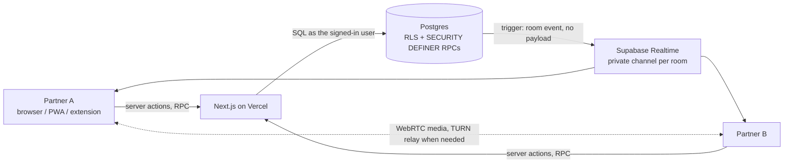

# Duri (둘이) · a private two-person room for couples

**Live:** https://duri-chrome-starter.vercel.app · Next.js 16 · TypeScript · Supabase (Postgres, Auth, Realtime, Storage) · Vercel · Chrome extension (MV3)

Duri gives two people one shared room: a day counter and upcoming anniversaries, chat with voice and video calls, a shared photo album, watching videos in sync, a shared drawing board and eight real-time games. It runs as a website, an installable PWA and a Chrome toolbar popup, all from the same code and the same room.

The interesting part is not the feature list but the constraint behind it: **two browsers that do not trust each other must always agree**. Every rule (who can see a photo, whose turn it is, a poker hand, a secret number) is enforced in the database, and the screens only display what the server decides.

## Features

| Area | What it does |
|---|---|
| Room | Invite link (single use, expires), day counter, 100-day marks, anniversaries and both partners' birthdays within the next 100 days, five themes, Korean and English |
| Chat | Messages with read receipts, voice and video calls (WebRTC) that stay connected while you switch tabs |
| Album | Private photo album; one photo can become the shared room background |
| Watch together | YouTube, Vimeo, video files and Netflix (through the extension) kept in sync for both people |
| Drawing | A shared canvas both people draw on at once (pens, stamps, paper styles), saved to the album |
| Games | Guessing quiz, drawing quiz, gomoku, chess, mini golf (both play at once), postcard memory, heads-up poker, number baseball; rematches need the other person to accept |
| Surfaces | Website, PWA, Chrome popup and a persistent small window |

## Architecture



1. A screen calls a database function (for example `baseball_action(room, revision, 'guess', '820')`).
2. The function checks membership and the rules, writes the new state and bumps a **revision** number.
3. A trigger sends a content-free event on the room's private channel.
4. Both screens re-read their own view of the state. A replayed or stale revision changes nothing, so double taps and reconnects are safe.

## Engineering highlights

- **Security in the database, not the UI.** Row-level security on every table, 92 `SECURITY DEFINER` functions with `search_path=''`, direct table writes revoked. Hidden information (poker hole cards, number-baseball secrets, the drawing word) never leaves Postgres until the game is over; tests read the raw realtime payloads to prove it.
- **Fast small window.** The Chrome popup reloads the room every time it opens. Measured on the live site: sign-in checks now verify the JWT locally with the project's ECC key instead of an Auth round trip, cutting time-to-visible from ~0.5–0.65 s to ~0.25–0.33 s and the popup token call from 475 ms to 49 ms (`tests/flow/speed.spec.ts`, `Server-Timing` header).
- **Calls across networks.** Per-call, one-hour TURN credentials from a server route (the secret never reaches the browser), STUN fallback, and the chosen route (direct or relay) shown to the user.
- **Physics both sides agree on.** Mini golf runs the same simulation in PL/pgSQL and TypeScript; a test checks 270 shots for identical results.
- **Privacy by default.** Photos are re-encoded in the browser (drops GPS/EXIF) and served through a route that asks RLS; birthdays are stored as month-day only; leaving a room deletes its files.

## Testing

| Layer | Tool | Count |
|---|---|---|
| Pure logic (dates, scoring, physics, i18n) | `node:test` | 75 tests |
| Database rules and permissions | embedded Postgres, run as a non-root role | 34 tests |
| Browser (extension, PWA, games) | Playwright | 8 specs |
| Live two-person flow on the deployed site | Playwright, two browsers, fake camera/mic | 4 specs |

Every push runs type checking, unit, database, build and browser tests; after the deploy, the live flow signs two throwaway users in and plays through invites, chat, a real voice call, the album, games and account deletion.

## Repository map

```
src/core/        pure TypeScript rules shared by the web app and the extension (dates, games, physics)
src/app/         Next.js routes: room, chat, album, watch, games, settings, auth
src/lib/         Supabase clients and request-scoped room reads
supabase/        28 SQL migrations: tables, RLS, RPCs, realtime triggers, storage policies
extension/       Chrome MV3 popup, small window and the Netflix bridge
tests/           unit, database, browser and live-flow suites
docs/            ARCHITECTURE (decisions and trade-offs per phase), POLICIES, RELEASE, STATUS
```

## Run locally

```bash
npm ci
cp .env.example .env.local     # Supabase URL and publishable key; see the comments inside
npm run dev                    # http://localhost:3000
npm test                       # type check, unit, database, build and browser tests
npm run extension:build        # Chrome extension into dist/chrome-extension (load unpacked)
```

The database tests start their own embedded Postgres and need no Supabase project. Design decisions and the questions each phase answers are in [`docs/ARCHITECTURE.md`](docs/ARCHITECTURE.md).

## Credits

Built by Samuel Koo, with Thomas Kim (chess and the shared drawing board). A student project at the University of Waterloo; not affiliated with Netflix, YouTube or Vimeo.
